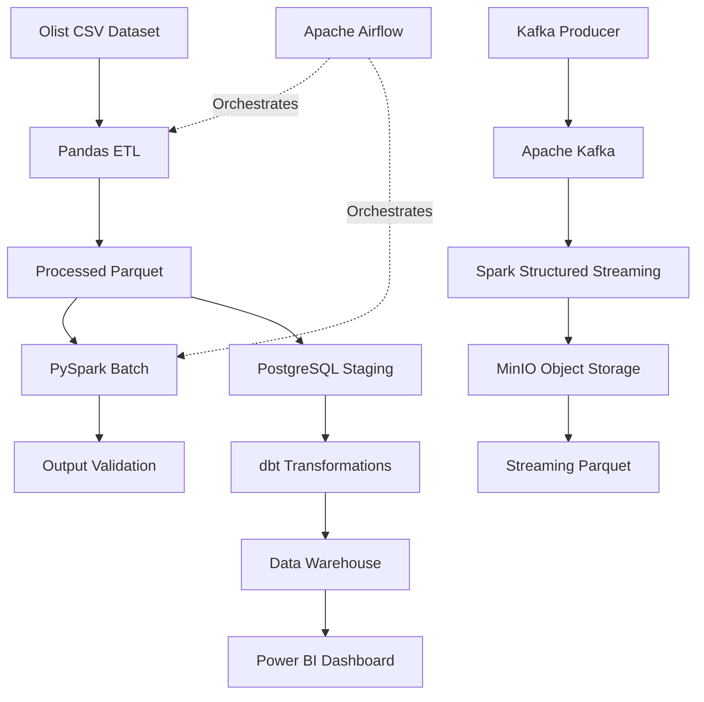
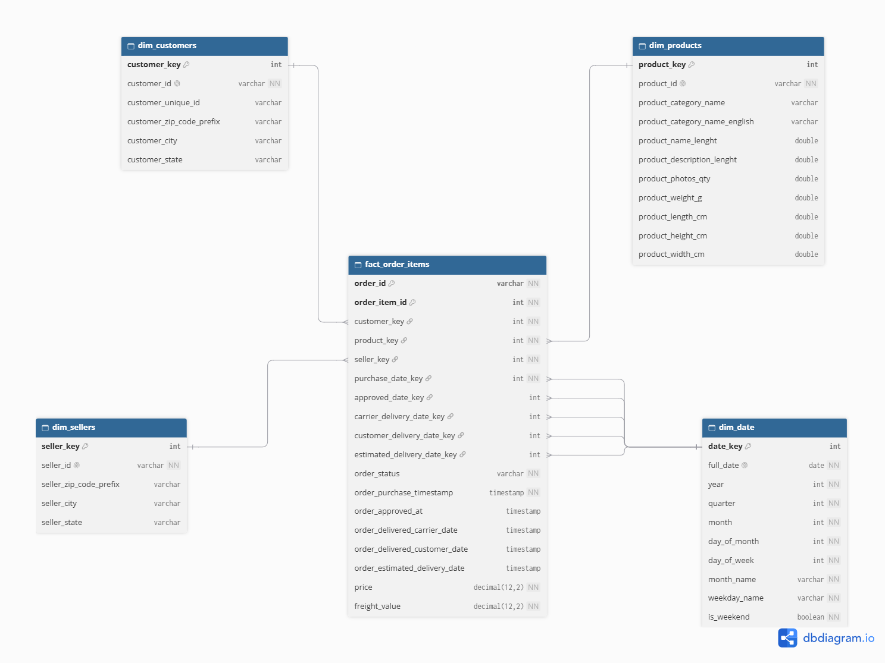

# 🛒 E-commerce Data Engineering Platform

### End-to-End Data Engineering Pipeline | Olist Brazilian E-commerce Dataset

Building a complete data platform to ingest, process, transform, store, and analyze e-commerce data using modern Data Engineering technologies.

<p align="center">
  
</p>

<p align="center">
  
  
  
  
  
  
</p>

---

##  Project Overview

This project implements an end-to-end E-commerce Data Engineering Platform based on the public Brazilian Olist dataset.

It combines independent batch and streaming pipelines to transform raw e-commerce data into structured analytical datasets and business insights.

###  Main objectives

- Build reliable batch and real-time data ingestion pipelines.
- Process and transform large datasets using Python and Spark.
- Orchestrate batch workflows with Apache Airflow.
- Store streaming data in MinIO using Parquet format.
- Build a dimensional data warehouse using PostgreSQL and dbt.
- Create analytical dashboards with Power BI.

##  Architecture

The platform contains two independent data processing paths and a separate analytics workflow.



> **Note:** The Airflow DAG orchestrates the batch workflow only. The Kafka-to-MinIO streaming pipeline, PostgreSQL loader, and dbt transformations are separate execution paths.

##  Technology Stack

| Component | Technology | Purpose |
|---|---|---|
| Programming | Python, Pandas | Data ingestion and cleaning |
| Batch processing | Apache Spark | Distributed data processing |
| Streaming | Apache Kafka | Event transportation |
| Stream processing | Spark Structured Streaming | Real-time processing |
| Object storage | MinIO | Parquet storage |
| Orchestration | Apache Airflow | Batch workflow orchestration |
| Data warehouse | PostgreSQL | Analytical storage |
| Transformation | dbt Core | Data modeling |
| Visualization | Power BI | Business intelligence |
| Infrastructure | Docker Compose | Service deployment |

##  Data Pipelines

### 1. Batch Data Pipeline

- Read the nine original Olist CSV datasets.
- Validate source files.
- Clean, standardize, and deduplicate records using Pandas.
- Generate processed Parquet datasets.
- Apply Spark batch transformations.
- Validate the generated outputs.

The batch workflow is manually triggered through Airflow.

### 2. Kafka Streaming Pipeline

- Produce validated order snapshot events.
- Publish events to the Kafka `orders` topic.
- Process incoming messages with Spark Structured Streaming.
- Write Parquet files to MinIO.
- Maintain streaming progress through Spark checkpoints.

### 3. Data Warehouse & Analytics

- Load processed datasets into PostgreSQL staging tables.
- Transform data with dbt.
- Build dimensions, facts, and aggregate models.
- Connect Power BI to the analytics tables.

##  Data Warehouse

The analytical warehouse includes:

- 9 staging tables
- 4 dimension tables
- 1 fact table
- 3 aggregate tables

<p align="center">
  
</p>

The dimensional model supports analytical queries related to customers, products, sellers, orders, revenue, and delivery performance.

##  Power BI Dashboard

The Power BI report provides an overview of e-commerce performance through KPIs and analytical charts.

Key indicators include:

- Total Revenue
- Total Orders
- Orders by Status
- Monthly Orders Trend
- Monthly Revenue Trend
- Monthly Freight Cost Trend
- Top 10 Product Categories by Revenue

 **Dashboard file:** [`powerbi/dashbord_ecommerce.pbix`](powerbi/dashbord_ecommerce.pbix)

##  Recorded Project Results

| Metric | Recorded result |
|---|---:|
| Rows in PostgreSQL staging | 1,289,091 |
| Order items | 112,650 |
| Distinct orders | 98,666 |
| dbt models | 19 |
| dbt tests passed | 59 |
| dbt warnings | 0 |
| dbt errors | 0 |
| Streaming Parquet files | 781 |
| Streaming records | 78,056 |

**Data quality note:** The read-only streaming validation identified one invalid JSON value and seven repeated event groups. These anomalies have not been corrected. The dbt test results apply to the dbt project, not to the independent streaming pipeline. See [`docs/data-quality.md`](docs/data-quality.md).

##  Getting Started

### Prerequisites

- Windows and Docker Desktop
- Docker Compose
- Python 3.11
- Java for local Spark execution
- The nine Olist CSV source datasets
- dbt Core with the PostgreSQL adapter

### Installation

```cmd
py -3.11 -m venv venv
call venv\Scripts\activate.bat
python -m pip install --upgrade pip
python -m pip install -r requirements.txt
copy .env.example .env
```

Configure your local `.env` file and dbt profile. Never commit real credentials.

### Start services

```cmd
docker compose up -d --build
docker compose ps
```

### Run the batch pipeline

Trigger the `olist_batch_pipeline` DAG manually through the Airflow UI.

The DAG tasks execute in this order:

```text
check_files
    ↓
ingest_data
    ↓
transform_data
    ↓
validate_output
```

### Run the streaming pipeline

In separate CMD windows:

```cmd
python -m src.ingestion.kafka_producer
```

```cmd
python -m src.processing.kafka_spark_to_minio
```

### Run dbt

From the `ecommerce_dbt` directory:

```cmd
dbt debug
dbt parse
dbt run
dbt test
```

##  Repository Structure

```text
ecommerce-data-platform/
│
├── data/
│   ├── raw/                 # Original Olist CSV datasets
│   ├── processed/           # Processed Parquet files
│   ├── curated/             # Curated data
│   └── checkpoints/         # Spark streaming checkpoints
│
├── src/
│   ├── ingestion/            # Batch ETL and Kafka producer/consumer
│   ├── processing/           # Spark, cleaning and data loading
│   └── utils/                # Validation and utilities
│
├── dags/                     # Airflow DAGs
├── ecommerce_dbt/            # dbt project and models
├── schemas/                  # Kafka JSON schema
├── powerbi/                  # Power BI report
├── docs/                     # Technical documentation and images
│
├── docker-compose.yaml
├── Dockerfile
├── requirements.txt
└── README.md
```

##  Documentation

For more details, explore:

- [Architecture](docs/architecture.md)
- [Data Pipeline](docs/data-pipeline.md)
- [Data Quality](docs/data-quality.md)
- [Data Warehouse](docs/data_warehouse_technical.md)
- [Power BI Dashboard](docs/powerbi-dashboard.md)
- [Kafka Reference](docs/kafka-reference.md)

## 👩‍💻Author

**Rania Sirat**

Data Engineering Project | E-commerce Analytics

---

<p align="center">
  ⭐ If you find this project interesting, feel free to explore the repository!
</p>
