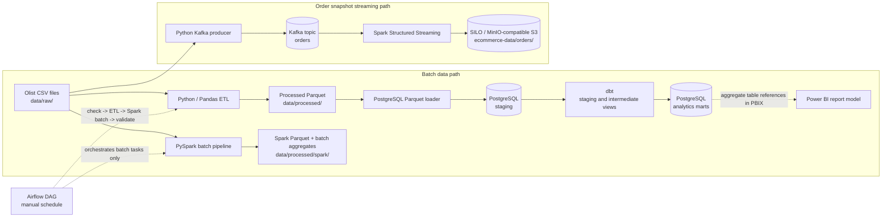

# Architecture

## Overview

The repository contains two related but independent data paths:

1. A **batch path** that prepares the Olist CSVs, validates Parquet outputs,
   loads processed files into PostgreSQL staging, and uses dbt to build the
   analytics marts.
2. An **event path** that publishes order snapshots to Kafka and uses Spark
   Structured Streaming to write Parquet to the S3-compatible SILO/MinIO
   service.

The Airflow DAG orchestrates only the batch file check, Pandas ETL, Spark batch
transform, and output validation. It does not invoke the Kafka producer,
streaming sink, PostgreSQL loader, or dbt.

## Architecture diagram

The diagram distinguishes the two outputs: batch Parquet under `data/` and
streaming Parquet in object storage. The code does not define a step that
automatically loads the MinIO streaming output into the dbt warehouse.

## Technology roles

| Component | Implemented role |
|---|---|
| Python and Pandas | Read raw CSVs, normalize columns and strings, convert dates, remove duplicates by configured keys, and write processed Parquet. |
| Apache Airflow | Manually triggered `olist_batch_pipeline` DAG for the batch file check, Pandas ETL, Spark batch transform, and output validation. |
| Apache Kafka | KRaft broker carrying order snapshot messages on the `orders` topic. |
| Spark batch | Reads Olist CSVs, cleans selected tables, creates batch Parquet outputs and category/month/status aggregates. |
| Spark Structured Streaming | Reads Kafka values, parses the event schema, preserves Kafka metadata and raw values, and writes append-mode Parquet. |
| SILO / MinIO-compatible S3 | Stores streaming Parquet in bucket `ecommerce-data`, under `orders/`. |
| PostgreSQL | Stores the `staging` source tables and dbt `analytics` relations; the Compose stack also defines PostgreSQL for Airflow metadata. Connection settings are managed separately. |
| dbt | Defines nine staging models, two intermediate models, and eight mart tables. |
| Power BI | Report model whose visuals reference the monthly, status, and product aggregate tables in `analytics`. |

The Compose file defines Kafka 4.0, a SILO/MinIO-compatible service, Redis,
PostgreSQL, and Airflow services. The custom Airflow image is based on Airflow
3.4 / Python 3.11 and installs Java and Spark dependencies.

## Warehouse model

The dbt source `ecommerce_staging` points to PostgreSQL schema `staging`.
Staging and intermediate dbt models are views; marts are tables in schema
`analytics`. The star schema centers on `fact_order_items`, at one row per
`(order_id, order_item_id)`, with customer, product, seller, and date
dimensions.

`dim_date` is role-playing: the fact model joins it for purchase, approval,
carrier delivery, customer delivery, and estimated delivery dates. The
corresponding foreign-key columns are nullable when the source date is absent.
The relationship diagram is available at
[`images/data_warehouse_schema.png`](images/data_warehouse_schema.png).

## Runtime boundaries

- Airflow's DAG uses Bash tasks inside the Airflow container and the mounted
  project files.
- The Kafka producer and Spark-to-MinIO streaming script are standalone
  commands; they are not DAG tasks.
- The PostgreSQL loader is a separate script. It truncates target staging
  tables before loading and must be treated as a data-changing operation.
- dbt is run from `ecommerce_dbt` with its PostgreSQL profile; it is not a
  service in the Compose file.
- The PBIX report contains an embedded data model. Static inspection confirmed
  table references, but did not establish its last refresh time or current
  connection mode.
