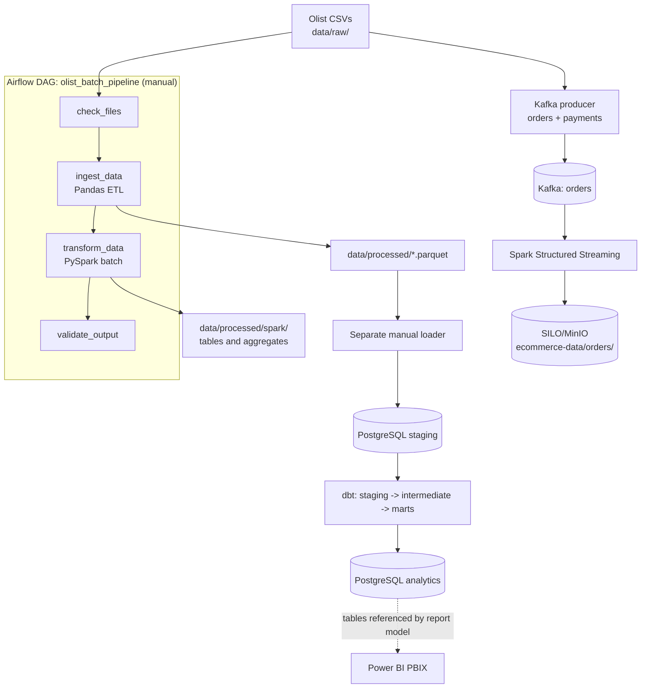

# Data Pipeline

## Pipeline boundaries

The repository implements a batch workflow and a separate Kafka streaming
workflow. They share Olist source files and the broader analytics use case, but
the current Airflow DAG does not orchestrate all steps end to end.



## 1. Source data

The project expects the nine Olist CSVs in `data/raw/`. The batch scripts read
the files directly; no download or scraping step is implemented in the
repository. The Airflow `check_files` task verifies that the expected inputs
exist and are non-empty.

## 2. Kafka event publication

`src/ingestion/kafka_producer.py` reads the orders and order-payments CSVs.
It sums `payment_value` by `order_id`, builds one `order.snapshot` payload per
source order row, validates the payload against
`schemas/order-event.schema.json`, serializes it as JSON, and publishes it to
the `orders` topic. The Kafka message key is `order_id`.

`event_id` is stable per order in the current implementation, while
`event_timestamp` is generated at publication time. Re-running the producer
can therefore publish the same business snapshot again with a new timestamp.

The separate `src/ingestion/kafka_consumer.py` validates topic messages and
prints valid events to standard output. It is not the Spark streaming
application.

## 3. Spark Structured Streaming

`src/processing/kafka_spark_to_minio.py` reads the `orders` topic, parses the
value using a Spark `StructType`, and writes append-mode Parquet. It retains
the raw Kafka value, key, topic, partition, and offset alongside the parsed
event fields. It adds an ingestion timestamp.

The script uses the configured S3-compatible endpoint, writes to
`s3a://ecommerce-data/orders/`, and stores its checkpoint at
`data/checkpoints/kafka_spark_streaming/orders_parquet_minio`. The checkpoint
tracks stream progress and is not an output directory to clean casually.

`src/processing/kafka_spark_streaming.py` is a separate console sink, not the
MinIO output pipeline.

## 4. Batch cleaning and Parquet

The Pandas ETL in `src/ingestion/etl_pipeline.py`:

1. Reads each configured CSV.
2. Standardizes column names and trims strings.
3. Converts configured dates; conversion failures become `NaT` and are logged.
4. Removes duplicate rows using the business keys in
   `src/processing/config.py`; rejected duplicates are written under
   `data/processed/rejected/`.
5. Preserves missing values and writes table Parquet files under
   `data/processed/`.

The separate `src/processing/olist_spark_pipeline.py` reads raw CSVs with
PySpark, cleans the configured Spark tables, writes Parquet under
`data/processed/spark/`, and produces monthly, status, and category aggregates.
It can compare table row counts with the Pandas Parquet outputs when those
files exist.

## 5. Airflow batch orchestration

The only DAG found in `dags/` is `olist_batch_pipeline`. It has `schedule=None`
and is intended for manual triggering. Its dependency chain is:

```text
check_files -> ingest_data -> transform_data -> validate_output
```

The DAG does not invoke the PostgreSQL loader, Kafka producer, either
Structured Streaming script, or dbt.

## 6. PostgreSQL staging load

`src/processing/load_parquet_to_postgres.py` reads the nine table Parquet files
from `data/processed/` and inserts them into schema `staging`. It creates
missing tables, truncates each destination table, inserts the Parquet rows,
and checks the resulting row count. This loader is separate from the Airflow
DAG and is not a read-only operation.

## 7. dbt transformations and analytics tables

The dbt project is `ecommerce_dbt/` (there is no root directory named `dbt/`).
Its source definition references the nine PostgreSQL tables in `staging`.

| Layer | Models | Materialization |
|---|---:|---|
| Staging | 9 | Views |
| Intermediate | 2 | Views |
| Marts | 8 | Tables |

The marts consist of four dimensions, `fact_order_items`, and three
aggregations:

- `agg_monthly_sales`: one row per purchase month; distinct orders, item rows,
  price, freight, and total item amount.
- `agg_orders_by_status`: one row per status; distinct orders and item rows.
- `agg_top_products`: product/category measures joined to `dim_products` by
  `product_key`.

The fact table grain is one order item. Payments are not joined to order-item
rows in the fact model.

## 8. Power BI

The existing report is `powerbi/dashbord_ecommerce.pbix`. Its report metadata
references `analytics.agg_monthly_sales`, `analytics.agg_orders_by_status`,
and `analytics.agg_top_products`. The PBIX is not generated by dbt or the
Airflow DAG. See [Power BI Dashboard](powerbi-dashboard.md) for the visuals and
refresh limitations.

## Operating note

Keep the streaming and batch outputs distinct. The repository does not
implement an automatic step from the MinIO streaming Parquet path into
PostgreSQL staging or dbt. Any such integration would need its own documented
loader, checkpoint/replay policy, and data-quality handling.
